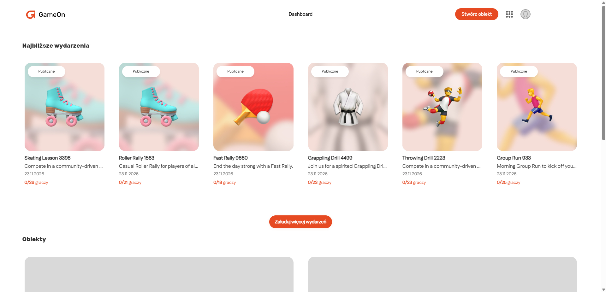
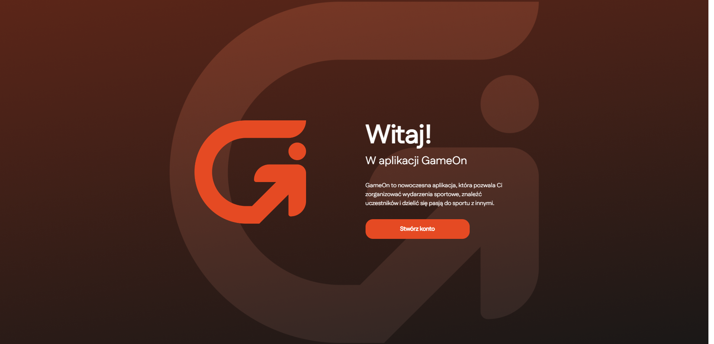
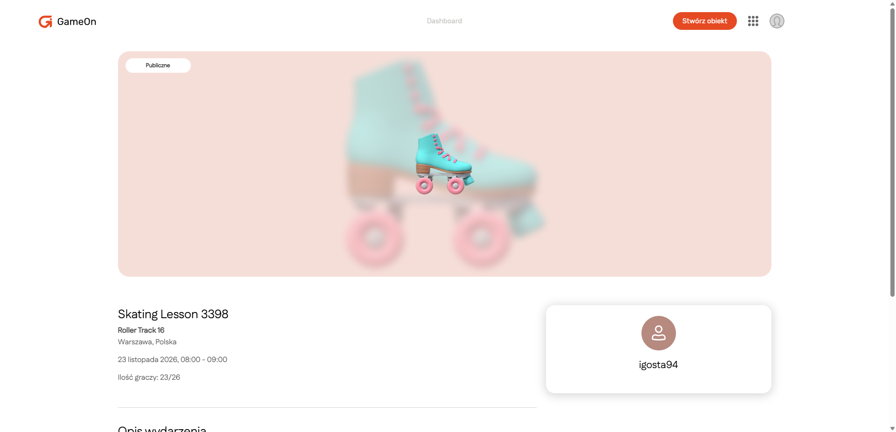
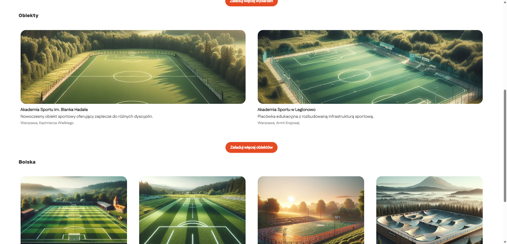
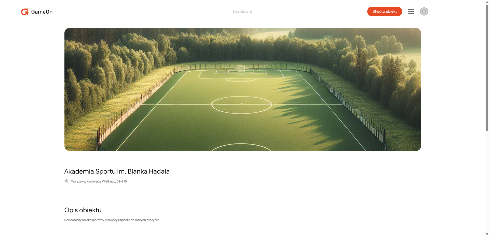

# GameOn: Web Frontend

GameOn is a platform for organizing and joining local sports events. Players browse upcoming games and join them; owners of sports facilities list their venues and fields, and manage the events played there.

This repository holds the **React web client**. It was built as a team project at Warsaw University of Technology (October 2024 – June 2025) by a 12-person Scrum team split into backend, web, Android and design groups. The backend (Java, Spring Boot) and the Android app (Kotlin) live in separate repositories that are not public.

> This is a portfolio copy of the web client, published without the original commit history.



## What the app does

- **Accounts and roles**: registration, login with JWT, password recovery, and choosing a role (player or facility owner).
- **Dashboard**: upcoming events, facilities and fields, with filtering and "load more" paging.
- **Events**: event details, participant list, creating new events with date and time selection, joining events.
- **Facilities and fields**: facility details with photos, opening hours, fields per facility, creating new facilities and fields.
- **Owner view**: an owner profile and a dashboard tailored to people who run sports facilities.
- **Map**: events and venues on an OpenStreetMap map (Leaflet).

## My contribution

I was one of the web frontend developers. My work included:

- Building the **home dashboard**: its layout and menu, event filtering, and the owner-specific version of the screen.
- A reusable **EventCard** component used for events, facilities and fields.
- The **event participants list** and connecting event and facility creation forms to the backend API.
- The **owner profile** and showing facility photos on the facility detail page.
- Connecting the **user profile** and **role selection** to the backend, plus a confirmation notification after registration.
- The **date picker** for event dates, and refactoring of the project structure and shared code.

## Tech stack

- React 18, React Router
- CSS Modules
- MUI date pickers, react-datepicker
- Leaflet / react-leaflet (maps)
- JWT authentication against a REST API

## Screenshots

| Welcome | Event details |
|---|---|
|  |  |

| Facilities and fields | Facility details |
|---|---|
|  |  |

Screenshots were taken locally with the project's demo seed data.

## Running locally

Requirements: Node.js 18 or newer, and the GameOn backend running on `http://localhost:8080`.

```bash
npm install
npm start
```

The app opens on `http://localhost:3000`. To point it at a different backend, set `REACT_APP_API_URL`:

```bash
REACT_APP_API_URL=https://api.example.com npm start
```
